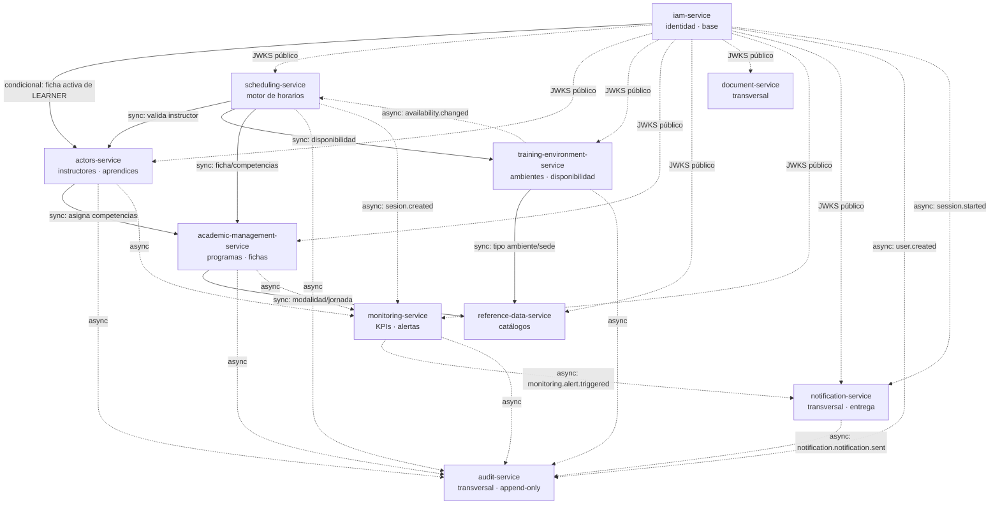

# Dependencias del Proyecto

> Estado: 🟡 Revisión | Última actualización: 2026-10-21
> Autor: Jesús Ariel González Bonilla (PM + Arquitecto) | Equipo: Arquitectura

Dependencias internas (entre servicios) y externas (infraestructura y terceros) del proyecto **Horarios SENA**. Es la vista de gestión de proyecto; el detalle técnico de acoplamiento vive en [dependency-map.md](https://github.com/code-sena/design-software-docs/blob/917d7f6b514a4ff48d86f7ae78273f06e0df8a1c/09-microservices/dependency-map.md).

## Principios

- `iam-service` provee identidad/JWKS para validación local del JWT. Su implementación existente consulta Actors condicionalmente al emitir `ficha_id` para LEARNER; no es una dependencia probada por el smoke con cuenta INSTRUCTOR de esta entrega.
- `reference-data-service` provee los **catálogos** (modalidad, jornada, tipo de ambiente, sede) que consumen los servicios de dominio.
- `scheduling-service` es el **consumidor pesado**: depende de `training-environment`, `actors` y `academic-management`.
- `document-service`, `audit-service`, `monitoring-service` y `notification-service` son **transversales**. `notification-service` (entrega email/IN_APP) se extrajo de `monitoring` por [ADR-005](https://github.com/code-sena/design-software-docs/blob/917d7f6b514a4ff48d86f7ae78273f06e0df8a1c/05-architecture/decisions/records/ADR-005-microservices-topology-and-transversal-capabilities.md); esta revisión IAM no vuelve a certificar su operación ni un E2E con la entrega actual.
- Regla de frontera: máximo **2 dependencias síncronas** por servicio (excluyendo IAM). `scheduling-service` la excede y se resuelve con read models de [ADR-002](https://github.com/code-sena/design-software-docs/blob/917d7f6b514a4ff48d86f7ae78273f06e0df8a1c/05-architecture/decisions/records/ADR-002-scheduling-read-models.md).

## Diagrama de dependencias

Sólido = llamada síncrona (acoplamiento fuerte). Punteado = evento asíncrono (acoplamiento débil). La autenticación contra IAM se omite del grafo por claridad (todos dependen de IAM para validar JWT).

## Dependencias internas (síncronas)

| Servicio | Depende de (sync, excl. IAM) | Motivo | ¿Cumple regla ≤2? |
|----------|------------------------------|--------|-------------------|
| `iam-service` | actors (condicional) | Consulta ficha activa al emitir JWT de LEARNER si está configurada; implementación previa, integración real no acreditada por este plan. | ✅ 1 |
| `reference-data-service` | — | Provee catálogos, no consume negocio. | ✅ 0 |
| `academic-management-service` | reference-data | Catálogos de modalidad/jornada. | ✅ 1 |
| `training-environment-service` | reference-data | Tipo de ambiente / sede. | ✅ 1 |
| `actors-service` | academic-management | Asignar competencias al instructor. | ✅ 1 |
| `scheduling-service` | actors, training-environment, academic-management | Validar instructor, disponibilidad y ficha al crear horario. | ⚠️ 3 → ADR-002 |
| `document-service` | — | Transversal; recibe datos por solicitud/evento. | ✅ 0 |
| `monitoring-service` | — | Sólo consume eventos. | ✅ 0 |
| `notification-service` | — | Transversal; sólo consume eventos y entrega por canales (email/IN_APP). | ✅ 0 |
| `audit-service` | — | Sólo consume eventos (append-only). | ✅ 0 |

## Dependencias internas (asíncronas / eventos)

El diseño prevé publicar mutaciones relevantes y consumirlas en servicios transversales mediante el broker de [ADR-001](https://github.com/code-sena/design-software-docs/blob/917d7f6b514a4ff48d86f7ae78273f06e0df8a1c/05-architecture/decisions/records/ADR-001-message-broker.md). La persistencia de un evento en outbox no demuestra publicación o consumo; la entrega IAM examinada no tiene broker/consumidor validado.

- **`audit-service`** consume eventos de todos los servicios (log append-only de todas las mutaciones).
- **`monitoring-service`** consume eventos de dominio (`sesion.created`, `conflict.detected`, `instructor.assigned`, `ficha.opened/closed`, etc.) para KPIs y alertas.
- **`scheduling-service`** consume `availability.changed` de `training-environment-service` para invalidar/actualizar sus read models.
- **`notification-service`** (transversal, extraído de `monitoring` por [ADR-005](https://github.com/code-sena/design-software-docs/blob/917d7f6b514a4ff48d86f7ae78273f06e0df8a1c/05-architecture/decisions/records/ADR-005-microservices-topology-and-transversal-capabilities.md)) tiene el rol de consumir `monitoring.alert.triggered` y otros eventos notificables, realizar entrega con retry/DLQ y publicar `notification.notification.sent`. `monitoring` publica la alerta. Los antecedentes de E2E en `develop` requieren sus propias referencias/versiones y no acreditan el consumidor de las PR IAM actuales.

## Dependencias externas

| Dependencia | Tipo | Uso | Estado | Riesgo asociado |
|-------------|------|-----|--------|-----------------|
| **PostgreSQL 16** | Base de datos | Motor relacional de cada servicio; esquema versionado con Liquibase. | ✅ En uso (capa de datos) | — |
| **Liquibase** | Herramienta de migración | Versionado y despliegue del esquema por repo `*-db`. | ✅ En uso | R-002, R-009 (ver [risks.md](./risks.md)) |
| **Driver JDBC PostgreSQL** | Librería | Conector usado por Liquibase. | ⚠️ Versión obsoleta | R-009 |
| **Docker** | Runtime/orquestación local | PostgreSQL local y construcción/orquestación de servicios | 🟡 DB local ensayada; imagen Service nueva no validada por fallo DNS al descargar imagen base | R-014 |
| **Broker de mensajes** ([ADR-001](https://github.com/code-sena/design-software-docs/blob/917d7f6b514a4ff48d86f7ae78273f06e0df8a1c/05-architecture/decisions/records/ADR-001-message-broker.md)) | Middleware async | Transporte de eventos hacia `audit`, `monitoring` y `notification` | 🟡 Requerido; IT de relay IAM omitido por broker ausente en el ensayo. E2E de la combinación actual pendiente (TD-010). | R-005 |
| **Object storage** ([ADR-003](https://github.com/code-sena/design-software-docs/blob/917d7f6b514a4ff48d86f7ae78273f06e0df8a1c/05-architecture/decisions/records/ADR-003-object-storage.md)) | Almacenamiento binario | Guardar PDFs/exports de `document-service` (sólo `storage_key` en BD). | 🔴 No provisionado | — |
| **Secret Manager** | Gestión de secretos | Alojar credenciales hoy en `.env.*` versionados. | 🔴 Pendiente | R-001 |

## Combinación y acceso verificados para IAM

Las PR Service #43, DB #79 y MFE #10 están abiertas, sin fusionar. La combinación local revisada fue Service `7c837e0824263cef0aef89f807731adca839f25e`, esquema DB heredado de `a1e01a42692da77269568f0ef49b2e4d3d035fa3` y MFE `e73e844bebebb64b99bfce24a908926f0e4cf76b`. La rama DB `7fe2798cf5d5c90b6e51509e6dd052f1929f81b8` conserva ese esquema y añade preflight/CI/documentación. No hay DDL nuevo.

| Dependencia IAM | Evidencia y situación al corte | Acción pendiente |
|---|---|---|
| PostgreSQL 16 / Liquibase 4.29 | 37 changesets desde cero, validate, update repetido sin cambios y preflight aprobados localmente y en CI DB | Verificar usuario de aplicación y base compartida; no usar el propietario del ensayo como prueba de mínimo privilegio |
| `design-software-frontend-platform` | Local `file:` en repo hermano, commit `be8bd79fa0e5e33955c481d928c3867077ff851e` | Conservar acceso/versionado reproducible para build MFE |
| `design-software-design-system` | Local `file:` en repo hermano, commit `b1c8b763b6f812173a11b232e35fed15b4c2f62b` | Conservar acceso/versionado reproducible para build MFE |
| Acceso CI a repositorios frontend privados | `FRONTEND_DEPENDENCIES_READ_TOKEN` ausente; CI MFE falló antes de instalación/pruebas | Responsable con acceso al repositorio configura secreto de lectura; volver a obtener CI completa, sin publicar el valor |
| Shell, broker/consumidores y observabilidad | El smoke del adaptador mediante proxy acredita API/DB; no montaje en navegador ni ingesta real | Ejecutar y anexar aceptación E2E de la combinación versionada |

Fuentes/resultados: [expediente IAM](../11-quality/plan-mejoramiento/iam-kevin-stiven-lopez-amaya/README.md) y [CI/CD](../10-devops/ci-cd.md). La lista no asigna a IAM resultados de otros servicios o participantes.

## Orden de construcción recomendado

Derivado de las dependencias: `iam` → (`reference-data`) → `academic-management` / `training-environment` → `actors` → `scheduling` → transversales (`document`, `audit`, `monitoring`). Ver fases A–E en [technical-backlog.md](./technical-backlog.md).
